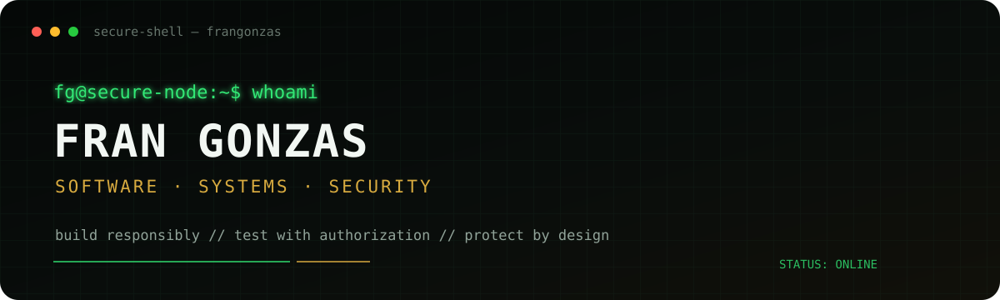

  

  <code>CONSTRUIR</code>&nbsp;·&nbsp;<code>ANALIZAR</code>&nbsp;·&nbsp;<code>PROTEGER</code>&nbsp;·&nbsp;<code>MEJORAR</code>

# Fran Gonzas · Ingeniería de software y seguridad

Desarrollo software con especial interés por la **seguridad, la privacidad, los sistemas distribuidos y las comunicaciones resistentes a fallos**. Combino ingeniería de producto con investigación práctica en el ecosistema Apple, redes P2P, identidad criptográfica y entornos Linux.

> La seguridad no es decoración: es arquitectura, verificación y gestión disciplinada de la confianza.

## Perfil técnico

| Área | Descripción |
|---|---|
| **Desarrollo** | Swift, SwiftUI, Python, Shell, HTML, CSS y JavaScript |
| **Ecosistema Apple** | iOS, macOS, Xcode, CryptoKit, CloudKit y MultipeerConnectivity |
| **Redes y sistemas** | Linux, Kali Linux, APIs REST, P2P y sincronización distribuida |
| **Seguridad** | Identidad segura, cifrado, modelado de amenazas y privacidad por diseño |
| **Metodología** | Aprendizaje continuo, prototipado, pruebas y documentación |

## Investigación en seguridad

| Laboratorio | Enfoque | Recursos |
|---|---|---|
| [OnyxKode Security Lab](https://github.com/frangonzas/OnyxKode-Security-Lab) | Validación, comunicaciones seguras y autorización | [Ficha técnica](labs/onyxkode-security-lab/README.md) |
| [Swift Crypto Lab](https://github.com/frangonzas/Swift-Crypto-Lab) | CryptoKit, ciclo de vida de claves y cifrado autenticado | [Ficha técnica](labs/swift-crypto-lab/README.md) |
| [P2P Research](https://github.com/frangonzas/P2P-Research) | Descubrimiento, confianza, autorización y fallos de transporte | [Ficha técnica](labs/p2p-research/README.md) |
| [iOS Security Toolkit](https://github.com/frangonzas/iOS-Security-Toolkit) | Comprobaciones defensivas para aplicaciones Swift | [Ficha técnica](labs/ios-security-toolkit/README.md) |

Recursos compartidos: [modelo de amenazas](docs/THREAT-MODEL.md), [lista de verificación de seguridad](docs/SECURITY-CHECKLIST.md), [política de divulgación responsable](SECURITY.md) y [colaboración](CONTRIBUTING.md).

## Proyectos seleccionados

### [Onyx Flipper Lab](https://github.com/frangonzas/Onyx-FlipperZero-Lab)

Aplicación externa para **Flipper Zero** orientada a auditorías de campo autorizadas: GPIO, métricas Sub-GHz en recepción, inspección IR/NFC/LF RFID, utilidades de aleatoriedad y generación de informes con protección de datos. La documentación del proyecto identifica **v3.0.0** como versión final verificada.

### [Onyx RF Lab para macOS](https://github.com/frangonzas/Onyx-RF-LAB.V3.0.1)

Observatorio de radiofrecuencia con **HackRF One**, espectro en recepción, histórico de actividad, trazas RF e inventario Bluetooth del propio macOS. Separa expresamente la energía radioeléctrica de la identidad de los dispositivos.

### [Onyx RF Lab para Windows](https://github.com/frangonzas/Onyx-RF-Lab-Windows)

Edición nativa Windows con .NET/WPF, visualización de espectro, cascada (*waterfall*), mediciones relativas y observaciones BLE. Incluye instrucciones para obtener el ejecutable mediante GitHub Actions.

### [Wardrive Track](https://github.com/frangonzas/Wardrive-Track)

Análisis **Wi-Fi y Bluetooth/BLE** desde archivos PCAP/PCAPNG y registros GPS compatibles con ESP32 Marauder. Filtrado por seguridad WPA/WPA2/WPA3, cartografía de observaciones y exportación CSV/GeoJSON. Versión **0.3.0**.

### Otros proyectos de investigación

**OnyxKode** explora comunicaciones privadas, identidades criptográficas, intercambio cifrado y redes P2P. **KoleChat** investiga comunicaciones comunitarias y descubrimiento local. **Monthio** estudia visualización financiera, carteras y análisis de riesgo. Son áreas de trabajo y conceptos; no se presentan aquí como productos certificados ni disponibles comercialmente.

## Principios de ingeniería

- Comprender antes de automatizar.
- Reducir la superficie de ataque.
- Verificar la confianza y los límites de autorización.
- Minimizar la información sensible.
- Documentar el funcionamiento y los supuestos de seguridad.
- Probar fallos y situaciones degradadas.
- No incorporar claves ni secretos al repositorio.
- Comunicar vulnerabilidades con responsabilidad.

## Uso responsable

Todos los proyectos de seguridad publicados aquí están destinados a **aprendizaje, investigación defensiva y entornos propios o expresamente autorizados**. Una observación RF no identifica automáticamente un dispositivo ni una persona.

Si detectas una vulnerabilidad, revisa la [política de seguridad](SECURITY.md) antes de compartir detalles sensibles.

---

<strong>Fran Gonzas</strong> Software · Sistemas · Seguridad © 2026 · Investigación autorizada

